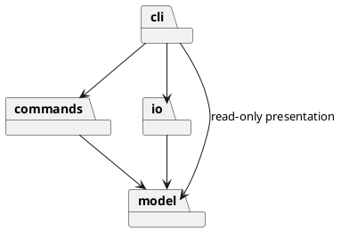

# SVG Editor · Lab1 Phase 1

使用 TypeScript 实现的面向对象 SVG 命令行编辑器。通过终端创建和编辑图形，维护嵌套分组，并将结果保存为浏览器可直接显示的 SVG 文件。

**Git 仓库地址：** [https://github.com/sunyanqi666/svg-editor-lab1](https://github.com/sunyanqi666/svg-editor-lab1)

仓库为私有仓库，主分支为 `main`，版本标签 `final` 标记当前最终版本。当前支持 `rect`、`circle`、`ellipse`、`line`、`text`、`g` 六种类型及 19 条命令。

## 安装与运行

需要 Node.js 22 或更高版本及 npm。进入项目根目录后执行：

```sh
npm ci
npm run cli
```

程序显示 `svg>` 提示符，逐行接受命令。输入 `help` 查看命令和各图形的参数，按 Ctrl+D 退出。

```text
init 800 600
create g node
create rect r1 100 100 160 60 #4a90d9 in node
create text title 120 135 "开始" in node
move node 50 0
undo
save demo.svg
```

将生成的 `demo.svg` 拖入浏览器即可预览。

### 命令与基本约定

| 类别 | 命令 |
| --- | --- |
| 文档 | `init [w] [h]`、`read <file.svg>`、`save [file.svg]`、`canvas [w] [h]` |
| 编辑 | `create <type> <id> [params…] [in <containerId>]`、`delete <id>`、`move <id> <dx> <dy>`、`scale <id> <factor>`、`set <id> <attr> <value>` |
| 层级 | `group <newGid> <id1> [id2…]`、`ungroup <gid>`、`addto <gid> <id>`、`front <id>`、`back <id>` |
| 显示 | `tree [id]`、`show <id>`、`help` |
| 历史 | `undo`、`redo` |

| 图形类型 | create 中 id 后的参数 |
| --- | --- |
| rect | `x y width height [fill]` |
| circle | `cx cy r [fill]` |
| ellipse | `cx cy rx ry [fill]` |
| line | `x1 y1 x2 y2 [stroke]` |
| text | `x y "content"` |
| g | 无；可通过 `in`、`addto` 或 `group` 构建层级 |

所有类型的 create 均可追加 `in <containerId>`，省略时放在画布根下。id 全局唯一且区分大小写；坐标原点在左上角，x 向右、y 向下，允许浮点数。

`set` 支持 `fill`、`stroke`、`stroke-width`、各类型的几何属性，以及 text 的 `text` 内容。未知属性报错。省略 fill/stroke 时不额外写入属性，外观遵循 SVG 默认值。

带空格的参数使用双引号；文本中的引号和反斜杠分别使用 `\"` 和 `\\`。以 `#` 开头的整行是注释，颜色中的 `#` 正常保留；不支持行尾注释。所有错误以 `error:` 开头并保持单行，参数数量错误显示对应的 `usage:`。

### 文件与历史语义

- `init` 默认创建 800×600 画布；`canvas` 无参数时查询尺寸，有两个参数时修改尺寸。
- `save` 无路径时使用最近一次成功 read 的路径。显式另存到 B 不改变此前 read A 的默认目标；新建且未读取过文件的文档，每次保存都须指定路径。`init` 清除读取路径。
- 成功执行 init、read、save 或修改画布尺寸后，清空旧历史并禁用 undo/redo，直到下一次成功编辑。查询 canvas 不影响历史。
- 一条编辑命令对应一个撤销单元。显示命令和失败命令不影响历史；撤销后执行新编辑会清空 redo。
- 删除容器会删除全部子孙，撤销时恢复完整结构和原顺序。svg 直接子节点中的 g 不允许 ungroup；嵌套 g 解散后，子节点占据原容器的位置。
- move 使用增量；scale 将位置与几何尺寸同乘正数因子，容器递归处理子孙。CLI scale 不额外缩放线宽或字号。
- group 跨父容器时按原文档遍历顺序收编，新组位于第一个目标原来的位置；包含祖先和子孙的目标集合被拒绝。
- front 将元素放在同级 SVG 节点末尾，即最上层；back 放在开头，即最下层。

## 架构方案

### 模块划分

| 模块 | 核心类或入口 | 职责 |
| --- | --- | --- |
| `src/model` | Shape、Group、六种图形实现、Document、ShapeFactory | 图形行为、属性校验、组合树、唯一 id 和画布；不接触终端或文件系统 |
| `src/commands` | EditCommand、具体编辑命令、History、Session | 执行编辑用例，管理活动文档及撤销重做 |
| `src/io` | SvgCodec、SvgTransform、SvgFileStore | SVG 解析与生成、导入变换处理、文件读写与路径管理 |
| `src/cli` | CommandRouter、CommandRoute、Tokenizer、Presenter、main | 分词、命令装配、参数校验、展示和 REPL |
| `test`、`fixtures`、`scripts` | 测试、案例、架构检查及演示脚本 | 功能验收、结构约束检查和可重复演示 |

模块依赖如下：



独立图源：[模块依赖图](doc/architecture.puml)、[关键类关系图](doc/classes.puml)。

### 设计模式及落地

**Command 模式。** 每类编辑行为由命令对象承担，例如 CreateCommand、MoveCommand 和 GroupCommand。EditCommand 定义 execute、undo、redo，具体命令实现 apply。History 维护已执行与可重做命令栈；Session 统一调用命令并替换活动文档。一条命令对应一个历史单元，复杂分组与删除也可一次撤销。

编辑时先复制当前文档，在副本上完成操作，成功后才替换活动状态。命令保留操作前后快照，以恢复节点、属性、父子关系和顺序。失败操作不进入历史，也不污染当前文档。

**Composite 模式。** Shape 定义 move、scale、set、clone 等统一行为。Rect、Circle、Ellipse、Line、Text 是叶子，Group 持有 Shape 子节点并递归转发移动和缩放。父节点变更由容器内部操作维护；插入时先检查循环、重复 id 和索引，再从原父节点摘除。

**Factory 模式。** ShapeFactory 用一份注册表保存六种类型的构造行为、缺省参数和创建语法，供 CLI 创建、SVG 读取及 help 共同使用。图形行为通过多态实现，不在业务代码中按图形标签反复分支。

按名字分派仅集中于 CommandRouter 的命令注册表与 ShapeFactory 的图形注册表。这两处是后续插件化阶段的**待重构点**；当前不实现 ShapeProvider、插件加载或 box 类型。

### 依赖方向规则

1. model 只依赖同层模型，不依赖 commands、io 或 cli。
2. commands 只依赖 model 和同层命令，不直接读取文件或打印终端消息。
3. io 依赖 model、XML 库及 Node 文件接口，不依赖 commands 或 cli。
4. cli 负责装配，可以依赖其余三层；展示通过 Session 的独立文档快照读取数据。

这些规则将图形行为、应用用例、文件格式和交互入口分离。图形模型与命令可被其他入口复用，文件读写错误不会侵入几何逻辑。

### 变化点假设

| 可能变化 | 当前处理与取舍 |
| --- | --- |
| 增加图形类型 | 用 Shape 多态和工厂集中构造；暂不实现插件加载，以控制当前阶段范围 |
| 增加 GUI 或 agent 入口 | 模型、命令和历史不依赖 stdin/stdout，可复用 Session |
| 增加文件格式 | SVG 读写独立为适配器；尚无第二种格式需求，因此不提前增加通用格式接口 |
| 编辑更大的文档 | 采用快照确保复杂撤销正确；未来可保留命令接口，将快照替换为局部差量 |

## 过程记录

开发过程使用 Codex 协作完成，按照需求分析、模型、CLI、层级操作、历史、文件读写和验收分步推进，并保留 Git 提交历史。关键迭代如下。

1. **明确阶段边界。** 阅读需求时区分六种内置图形与未来 box 插件，避免把后续目标混入当前实现。
2. **先约定架构，再接入 CLI。** 明确四层职责、依赖方向和失败原子性；选择 Command 与 Composite，并用文档快照处理复杂撤销。
3. **合并工厂分派。** 初稿为 XML 缺省值另建标签索引表。审查后将缺省参数、创建行为和帮助语法合并到同一注册表，避免增加分派位置。
4. **修正自动 id 分配。** 按读取顺序直接命名可能抢占后面的显式 rect1。改为先遍历保留所有显式 id，再生成缺失 id，并用回归测试验证。
5. **收紧 XML 校验。** 发现 XML 库可容忍根元素外的多余文字，增加前导内容与根节点外文本检查，覆盖 `<svg/>junk` 和 `junk<svg/>`。
6. **校正保存路径。** 对照需求发现初版把最近保存目标作为默认路径。修正为始终使用最近成功读取路径，并增加 read A / save B / save 的回归测试。
7. **强化封装。** 将公开父节点 setter 收紧为受保护的内部操作；容器插入先校验后摘除；Document.add 拒绝外部父容器；Session 对输入和读接口使用独立快照。通过 TypeScript 编译探针和运行时测试验证。
8. **统一参数校验。** 将分散的参数数量校验提取到 CommandRoute，错误输入显示具体用法；help 复用工厂语法信息。
9. **扩充场景验证。** 增加 48 层容器、多步撤销重做、跨父容器分组、样式继承和后序兄弟数值溢出等场景，恢复结果比较完整 XML。
10. **形成持续验证流程。** 增加两组真实 CLI 演示及 GitHub Actions 的 Node 22/24 检查，持续运行与本地相同的测试和架构约束。

## 一致性自查

### 模块划分

实际采用 model、commands、io、cli 四层，分别包含 9、12、3、5 个源文件，共 29 个 TypeScript 源文件。其中 28 个类文件遵循类名与文件名一致的规则，main.ts 是 REPL 装配入口。

实现与原模块职责一致。优化时新增 CommandRoute，使文件数从 28 增至 29；仅将参数校验从路由装配中移出，未改变依赖方向。

### 依赖方向

`npm run check:architecture` 使用 TypeScript AST 检查所有源文件的显式 import、类文件命名，以及 switch 和自由函数声明。当前检查通过，model 和 commands 不引入外部依赖。

代码抽查结果：MoveCommand 调用图形多态 move；Group 递归处理子节点；Session 只管理命令和历史；SvgFileStore 隔离磁盘操作；CommandRouter 解析参数、装配用例并展示结果。静态检查作为自动约束，配合这些行为层面的代码审查使用。

### 已记录的实现决策

- 跨父容器 group 的位置规则采用原文档遍历顺序，放在第一个目标原位置。
- 解散容器时，将其可继承样式补到未显式设置该属性的直接子节点，避免移除容器后丢失原样式。
- SVG 的 translate 与正数等比 scale 在读取时展开到叶子几何坐标；保存结果保持对应效果，但不保留原 transform 写法。
- Session 返回独立快照，外部修改不能绕过命令和历史机制。
- 快照复制直接连接已验证节点的副本，避免逐节点复制时重复进行全树插入校验。

逐项对应关系见 [需求与测试对应表](doc/requirements.md)。

## 质量保证手段

本地验证环境为 Node.js 24.15.0，TypeScript 启用 strict、noUncheckedIndexedAccess 和 noImplicitOverride。测试使用 Node 内置 test/assert。

| 验证项 | 方法与结果 |
| --- | --- |
| 功能与边界 | 29 项测试通过，覆盖六种类型、19 条命令、精确错误信息、默认样式和属性白名单 |
| 历史完整性 | 编辑前后保存完整 XML，逐步 undo/redo 比较结构、顺序、属性和文本；失败操作保持 redo |
| 组合树 | 验证 48 层嵌套、循环拒绝、跨父容器分组、删除恢复及兄弟节点的异常原子性 |
| 封装 | 编译探针验证父节点修改接口不可外部调用；运行时验证属性副本、文档快照和父容器归属 |
| SVG 与文件 | 验证编解码往返、缺 id 补齐、转义、导入变换、读写失败、默认保存路径及临时文件清理 |
| 架构 | 全部 29 个源文件通过依赖方向和类文件规则检查 |
| 端到端 | 真实 CLI 子进程回放流程图与层级历史案例，读取生成的 SVG 验证最终结果；已验证交互提示符和 Ctrl+D 退出 |
| 持续检查 | GitHub Actions 在 Node 22、24 下执行安装、测试、架构检查和两组演示 |

运行完整检查和演示：

```sh
npm run check
npm run demo
```

`npm run demo` 在临时目录中保存和验证结果，完成后自动清理。若希望生成固定的流程图文件，可运行：

```sh
npm run cli < fixtures/flowchart.commands
```

该命令生成或覆盖 `fixtures/flowchart.svg`。`fixtures/other.svg` 包含缺失 id 的导入案例；`fixtures/history.commands` 演示跨父容器分组和撤销重做。

文件读取先完成解析，再替换当前文档；保存先写同目录临时文件，成功后通过 rename 替换目标，避免部分写入。有效文档命令形成历史屏障，失败操作保持文档和历史状态。

持续检查结果可在 [GitHub Actions](https://github.com/sunyanqi666/svg-editor-lab1/actions) 查看。工作流只读，不自动修改代码或标签。

### 支持边界

当前实现以下 SVG 子集：六种内置类型、数字或 px 画布尺寸、与画布一致的 `viewBox="0 0 width height"`、嵌套 g、XML 文本转义、注释和 CDATA 文本。额外保留导入的 font-size（数字/px）、text-anchor、font-family、font-weight，但不将这些属性加入 CLI set 白名单。

导入支持 translate 和正数等比 scale；展开变换时同步处理涉及的文字大小与线宽。未知元素、style/CSS、路径、旋转、非等比缩放、百分比长度、其他 viewBox、嵌套文字标签和文档类型声明均明确报错。

box 和插件系统属于后续阶段，当前 create box 返回 unknown shape type。快照方案面向实验规模：单次快照的时间和空间开销为 O(n)，历史内存随文档规模及命令数量增长；多目标树重排另有遍历校验开销，不将全部编辑操作统一视为 O(n)。
