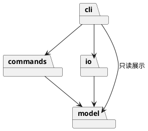

# Lab1 Phase 1：SVG 命令行编辑器

## 架构方案

### 模块划分

| 目录 | 职责 |
| --- | --- |
| `src/model` | 图形类、组合容器、文档树、几何和属性校验；不接触终端和文件系统 |
| `src/commands` | 编辑命令对象、历史管理、文档会话；在内存中执行应用用例 |
| `src/io` | 解析和生成 SVG、原子文件写入；文件路径归适配器管理 |
| `src/cli` | 参数分词、命令路由、文本展示和 REPL；入口装配依赖 |
| `test`、`fixtures` | 自动验收、外部 SVG 和命令回放 |

### 设计模式的选择

- **Command（必须）**：每类编辑操作一个命令类，统一 execute/undo/redo；一条命令对应一个历史单元。通过执行前后文档快照保证复杂树操作可以精确还原。
- **Composite**：Shape 抽象统一 move/scale/set，Group 组合 Shape；移动和缩放递归传递，删除以整棵子树为单位。
- **Factory**：ShapeFactory 集中管理六种类型的构造。命令名分发和工厂类型分发是仅有的两处按名字选择实现的位置。
- 当前命令注册表和图形工厂为有限内置表，**待后续插件化阶段重构**；本阶段不实现 ShapeProvider 或 box。

### 依赖方向规则

`model` 只依赖同层模型；`commands` 只依赖 model 和同层；`io` 依赖 model 和 XML/Node 文件适配；`cli` 负责装配、可以依赖前三层。下层不引用 CLI，不在图形类打印消息或读写文件。以架构检查脚本验证层间 import。

### 变化点假设

1. 图形类型会扩展：用多态隔离几何行为，用工厂集中创建；暂不做插件加载，避免提前实现下一阶段。
2. 入口可能变为 GUI 或 agent：命令与图形模型不依赖 stdin/stdout，可复用会话和历史。
3. 文件格式可能变化：SVG 读写独立为适配器；暂不提供其他格式接口，需求尚未出现。
4. 大文档可能使快照成本变高：先保证撤销正确性；未来可将快照换为局部差量，保留命令接口。

### 语义决策与待澄清项

- `scale` 按题目要求缩放位置和几何尺寸，不缩放 stroke-width；容器递归处理。
- 遵守题目限制：直接位于 svg 下的 g 不允许 ungroup；嵌套 g 可解散。
- `group` 跨父容器时按原文档遍历顺序收编，新组放在第一个目标原来的位置；目标间存在祖先关系时拒绝。
- 有效文档操作形成历史屏障，清空旧历史并禁用 undo/redo，直到下一次成功编辑。查询 canvas 不形成屏障；失败命令不影响历史。
- 本阶段对未知 SVG 元素、属性和不支持的变换显式报错，避免静默丢失数据；支持范围会在使用说明中列明。

## 过程记录

1. 阅读任务书后区分本阶段六种图形与后续 box 插件要求，避免把未来目标纳入当前实现。
2. 空目录开始建仓；先约定模块依赖和错误原子性，再实现 CLI，避免界面代码侵入模型。
3. 决定使用文档快照实现撤销；代价为每次编辑 O(n) 内存与时间，收益是删除、分组和跨容器操作都能恢复原顺序。

## 一致性自查

开发中；完成时以实际代码和检查结果补充，不预先声称通过。

## 质量保证手段

按阶段编译，最终使用 Node 内置测试覆盖正常操作、无状态污染的错误、撤销重做、SVG 往返及完整流程图回放。用独立架构脚本检查依赖方向；保存的 SVG 可直接在浏览器中预览。

## 阶段进度

- [x] 1. 需求梳理与架构设计
- [x] 2. 项目骨架与图形模型
- [ ] 3. CLI 与基础编辑
- [ ] 4. 分组与层级操作
- [ ] 5. 撤销与重做
- [ ] 6. SVG 文件读写
- [ ] 7. 验收、文档与提交
