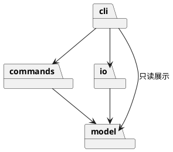

# Lab1 Phase 1：SVG 命令行编辑器

## 架构方案

### 模块划分

| 目录 | 职责 |
| --- | --- |
| `src/model` | 图形类、组合容器、文档树、几何和属性校验；不接触终端和文件系统 |
| `src/commands` | 编辑命令对象、历史管理、文档会话；在内存中执行应用用例 |
| `src/io` | 解析和生成 SVG、原子文件写入；文件路径归适配器管理 |
| `src/cli` | 参数分词、命令路由、参数校验、文本展示和 REPL；入口装配依赖 |
| `test`、`fixtures` | 自动验收、外部 SVG 和命令回放 |

### 设计模式的选择

- **Command（必须）**：每类编辑操作一个命令类，统一 execute/undo/redo；一条命令对应一个历史单元。通过执行前后文档快照保证复杂树操作可以精确还原。
- **Composite**：Shape 抽象统一 move/scale/set，Group 组合 Shape；移动和缩放递归传递，删除以整棵子树为单位。
- **Factory**：ShapeFactory 集中管理六种类型的构造。命令名分发和工厂类型分发是仅有的两处按名字选择实现的位置。
- 当前命令注册表和图形工厂为有限内置表，**待后续插件化阶段重构**；本阶段不实现 ShapeProvider 或 box。

### 依赖方向规则

`model` 只依赖同层模型；`commands` 只依赖 model 和同层；`io` 依赖 model 和 XML/Node 文件适配；`cli` 负责装配、可以依赖前三层。下层不引用 CLI，不在图形类打印消息或读写文件。以架构检查脚本验证层间 import。

### 变化点假设

1. 图形类型会扩展：用多态隔离几何行为，用工厂集中创建；暂不做插件加载，避免提前实现下一阶段。
2. 入口可能变为 GUI 或 agent：命令与图形模型不依赖 stdin/stdout，可复用会话和历史。
3. 文件格式可能变化：SVG 读写独立为适配器；暂不提供其他格式接口，需求尚未出现。
4. 大文档可能使快照成本变高：先保证撤销正确性；未来可将快照换为局部差量，保留命令接口。

### 语义决策与待澄清项

- `scale` 按题目要求缩放位置和几何尺寸，不缩放 stroke-width；容器递归处理。
- 遵守题目限制：直接位于 svg 下的 g 不允许 ungroup；嵌套 g 可解散。
- `group` 跨父容器时按原文档遍历顺序收编，新组放在第一个目标原来的位置；目标间存在祖先关系时拒绝。
- 有效文档操作形成历史屏障，清空旧历史并禁用 undo/redo，直到下一次成功编辑。查询 canvas 不形成屏障；失败命令不影响历史。
- 本阶段对未知 SVG 元素、属性和不支持的变换显式报错，避免静默丢失数据；支持范围会在使用说明中列明。

## 过程记录

1. 阅读任务书后区分本阶段六种图形与后续 box 插件要求，避免把未来目标纳入当前实现。
2. 空目录开始建仓；先约定模块依赖和错误原子性，再实现 CLI，避免界面代码侵入模型。
3. 决定使用文档快照实现撤销；代价为每次编辑 O(n) 内存与时间，收益是删除、分组和跨容器操作都能恢复原顺序。
4. 工厂实现初稿为 XML 缺省值另建了一张按标签索引的表，容易形成第二处图形分派；自查后把缺省参数和构造行为合并到同一注册表。
5. 自动补 id 不能只按读取顺序检测当前文档：前面的无名 rect 可能抢占后面的显式 rect1。采用先遍历保留全部显式 id、再生成缺失 id 的两遍策略，并用回归测试确认。
6. 检查发现 XML 库会宽容接受 `<svg/>junk`；增加根元素外文本校验，并补充正反两个方向的异常输入测试。
7. 用户授权新建远程仓库后，在 GitHub 创建私有 svg-editor-lab1 仓库，避免默认公开作业代码。
8. 回放任务书第 6 节会话和第 6.1 节流程图，以真实 CLI 子进程验证文本参数、撤销、元素数量与保存结果。过程记录是本轮 AI 实施和自查记录，没有虚构用户曾提出代码审查意见。

9. 用户要求在本阶段内逐项优化。对照 §3 发现 save 默认路径与初版实现不符，新增 read A / save B / save 回归用例后修正；新建文档无读取路径时需显式提供保存目标。
10. 封装审查发现公开父节点 setter 和 Session 活动文档引用可绕过校验；父节点改为 protected 静态操作，容器在摘除前校验 id/索引/循环，Document.add 拒绝外部父容器，Session 输入和读接口使用独立快照。用类型编译探针验证外部调用不可通过 TypeScript 检查。
11. 初版参数校验散落在 19 个路由中。提取 `CommandRoute` 类统一数量校验与 usage；help 从同一工厂注册表生成图形参数，没有增加按图形名字分派的位置。
12. 对 48 层嵌套、多步历史、跨父容器组、样式继承、后序兄弟数值溢出等增加场景验收；恢复比较由树文本扩展到完整 XML。
13. 增加 `npm run demo`，在临时目录中回放两个真实 CLI 会话，并验证保存的树和文字；保留原 fixtures 流程图，便于浏览器预览。
14. 增加 GitHub Actions 的 Node 22/24 矩阵检查；工作流只读，运行与本地一致的编译、测试、架构检查和演示，不自动编辑或发布。

## 一致性自查

1. **模块划分**：实际采用 `model / commands / io / cli` 四层，分别包含 9 / 12 / 3 / 5 个源文件，总计 29 个。与初始方案一致；没有临时上帝类或跨层文件读写。独立 PlantUML 源为 `doc/architecture.puml`。
2. **依赖方向**：`npm run check:architecture` 使用 TypeScript AST 检查全部源文件 import，未发现禁止的层间依赖；model 和 commands 无外部依赖。额外检查一类一文件、无 switch 分派和自由函数声明。该静态检查覆盖显式 import，不代替人工语义审查。关键类关系见 `classes.puml`，需求对应表见 `requirements.md`。
3. **抽样核对**：`MoveCommand` 只调用图形多态 move；`Group` 递归转发；`Session` 操作命令与历史，不读取文件；`SvgFileStore` 隔离磁盘；`CommandRouter` 只解析参数、装配用例和展示结果。
4. **按名字分派**：集中在 `CommandRouter` 和 `ShapeFactory`；工厂的 CLI 创建和 XML 读入使用同一份注册表。仅检查 `instanceof Group` 来识别容器能力，不按各叶子标签分支。

### 修订记录

- 在实现阶段明确跨父容器 group 的位置规则，并采用原文档遍历顺序；初始文档已记录此解释。
- SVG 读入额外支持示例中的 translate/等比 scale，规范化为绝对几何坐标；保留字体展示属性。未实现完整 SVG，支持边界列于根 README。
- 解散容器时把可继承的已有样式补到未显式设置该属性的直接子节点，避免丢失原组的外观。
- 本轮新增 `src/cli/CommandRoute.ts`，把参数数量验证从路由装配中移出；依赖方向不变，文件数从 28 调整为 29。
- 收紧 Group 与 Session 的封装并校正 save 路径；对外仍是原 19 条命令、六种类型、相同 set 白名单和历史屏障。
- 保留快照撤销；Group.clone 直接连接已验证的复制节点，避免在复制每个节点时反复扫描整树。

## 质量保证手段

验证环境：Node.js 24.15.0，TypeScript 严格模式。使用 Node 内置 test/assert，不依赖测试框架。

| 验证项 | 证据 |
| --- | --- |
| 编译 | `npm run build`，启用 strict、noUncheckedIndexedAccess、noImplicitOverride |
| 自动验收 | `npm test`：29 个用例，覆盖六种类型、19 条命令、异常原子性、分组顺序、继承样式、父子循环、48 层树、会话隔离与 save 路径 |
| 历史完整性 | 每一种编辑操作执行后，undo 比较整棵树与操作前相同，redo 比较与操作后相同；检查失败命令不清空 redo |
| 文件正确性 | SVG 编解码往返、缺 id 撞名、XML 转义、变换展开、读写失败、临时文件清理和文档历史屏障 |
| 端到端 | 真实子进程从 stdin 回放流程图，读取保存结果验证结构、文字、位置与 8 个元素；另通过真实 TTY 验证 svg> 提示符、编辑/撤销/展示及 Ctrl+D 退出 |
| 架构 | `npm run check:architecture` 检查全部 29 个源文件 |
| 演示 | `npm run demo`，两组真实 CLI 子进程回放和 SVG 校验，临时文件自动清理 |
| 持续检查 | `.github/workflows/ci.yml`，Node 22/24、main/PR/手动触发；自动运行 `npm run check` 和演示 |

失败编辑在副本文档上执行，不污染当前状态；读取先完整解析，成功后才替换当前文档；写入采用同目录临时文件加 rename，避免把目标文件写到一半。

测试验证任务书范围内的实验规模；不等价于支持全部 SVG 特性或无限规模。详细对应表见 [requirements.md](requirements.md)。

CI 使用官方 [actions/checkout](https://github.com/actions/checkout) 和 [actions/setup-node](https://github.com/actions/setup-node) 文档中的 v7，并明确设置 Node 版本和仓库只读权限。远程结果以 [Actions 记录](https://github.com/sunyanqi666/svg-editor-lab1/actions) 为准，工作流配置本身不当作已运行通过的证据。

## 阶段进度

- [x] 1. 需求梳理与架构设计
- [x] 2. 项目骨架与图形模型
- [x] 3. CLI 与基础编辑
- [x] 4. 分组与层级操作
- [x] 5. 撤销与重做
- [x] 6. SVG 文件读写
- [x] 7. 本地验收、文档与分阶段提交
- [x] 远程交付准备：按用户要求创建私有仓库 https://github.com/sunyanqi666/svg-editor-lab1；交付 main 分支的全部阶段历史和 final 标签。作业截止时间未提供，未声称验证截止要求。

## 本轮优化完成清单

- [x] 逐条需求复核，记录明确规则与实现解释。
- [x] 补充边界测试与精确错误文本验收。
- [x] 收紧父子关系、容器插入及会话封装。
- [x] 改进 usage 与六种图形 help，不改语法白名单。
- [x] 补充需求对应表、类关系图及可回放演示。
- [x] 配置 Node 22/24 GitHub Actions，与本地使用相同检查入口。
